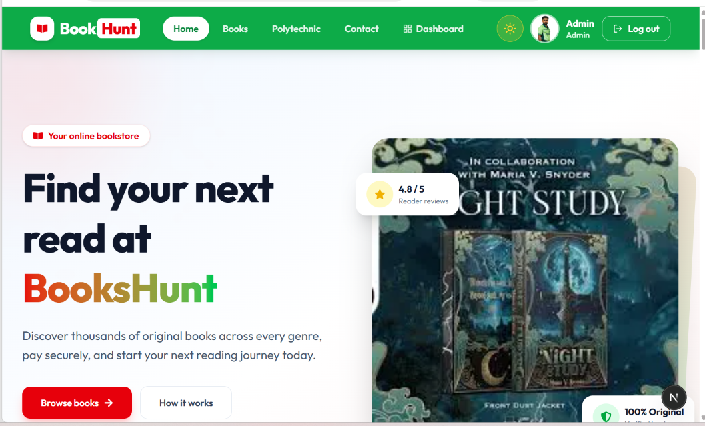
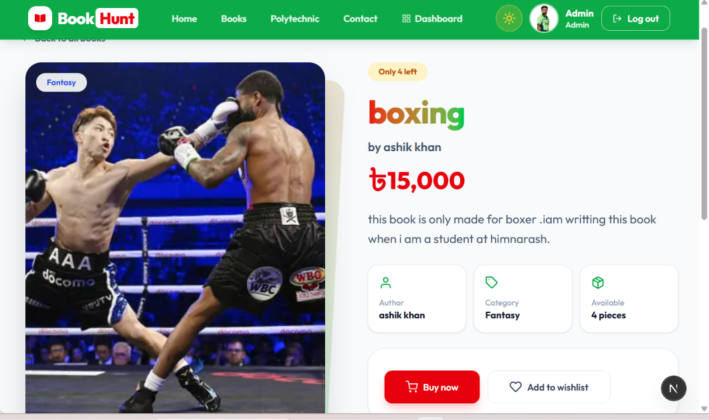
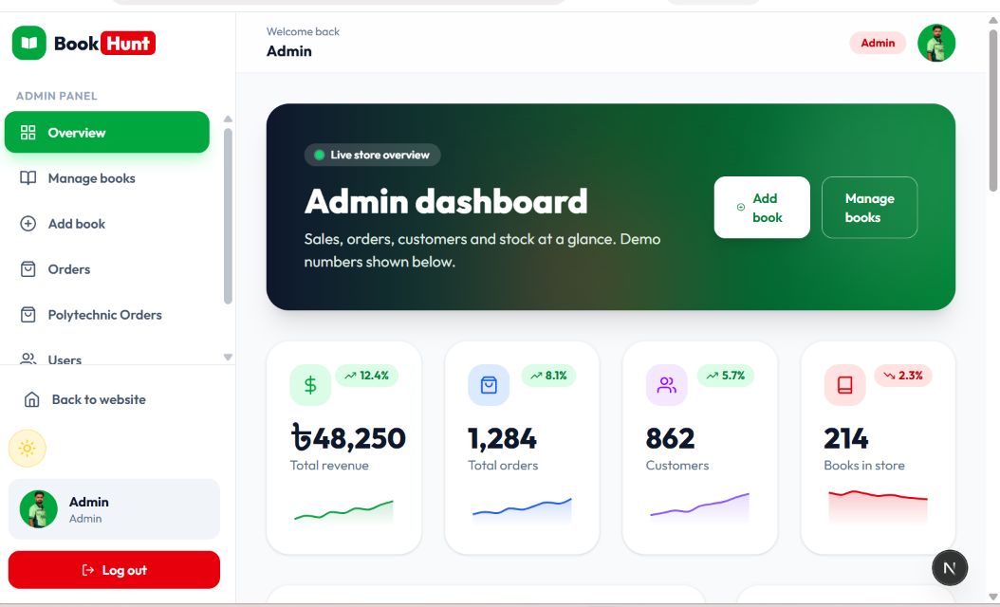
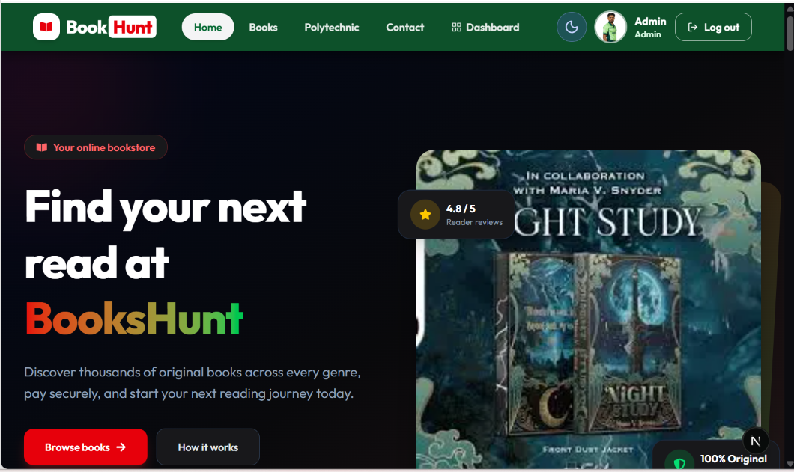

<div align="center">

# 📚 BooksHunt

### A full-stack digital book selling platform

Browse original books, pay securely with SSLCOMMERZ, and manage the whole store from an admin dashboard.

[**Live Demo**](https://book-hunt-omega.vercel.app/) · [**Client Repo**](https://github.com/halimaashu/book-hunt) · [**Server Repo**](https://github.com/halimaashu/book-hunt-server)


</div>

---

## 📸 Screenshots

<!-- Add your screenshots to an "assets" folder and update the paths -->

| Home | Book details |
| :---: | :---: |
|  |  |

| Admin dashboard | Dark mode |
| :---: | :---: |
|  |  |

---

## ✨ Features

### For readers
- Browse all books with **search** and **category filters**
- Detailed book pages with price, stock status and author
- **Secure online payment** with SSLCOMMERZ (sandbox ready)
- **Wishlist** to save favourite books
- Personal dashboard with **order history** and profile editing
- **Polytechnic book set orders** by department and semester
- Login with email and password or **Google**

### For admins
- **Role-based access** with protected admin routes
- Add, edit and delete books, with cover upload through ImgBB
- View all users, orders and Polytechnic set orders
- One-tap **Call** and **WhatsApp** buttons to contact customers
- Dashboard with charts built with Recharts *(demo data)*

### Everywhere
- Fully **responsive** design for phones, tablets and desktops
- **Light and dark mode**

---

## 🛠️ Tech Stack

| Area | Technologies |
| --- | --- |
| **Front end** | Next.js (App Router), React, Tailwind CSS, HeroUI, Recharts, React Icons |
| **Back end** | Node.js, Express.js |
| **Database** | MongoDB |
| **Authentication** | Better Auth (sessions, Google login, user roles) |
| **Payments** | SSLCOMMERZ |
| **Hosting** | Vercel |

---

## 🚀 Getting Started

### Prerequisites
- Node.js 18 or newer
- A MongoDB database (local or Atlas)
- An SSLCOMMERZ sandbox account
- A free [ImgBB](https://api.imgbb.com/) API key

### 1. Clone the repositories

```bash
# Client
git clone https://github.com/halimaashu/book-hunt
cd YOUR-CLIENT-REPO
npm install

# Server (in another folder)
git clone https://github.com/halimaashu/book-hunt-server
cd YOUR-SERVER-REPO
npm install
```

### 2. Add environment variables

**Client** (`.env.local`)

```env
BETTER_AUTH_SECRET=your_long_random_secret
BETTER_AUTH_URL=http://localhost:3000
DATABASE_URL=your_mongodb_connection_string
GOOGLE_CLIENT_ID=your_google_client_id
GOOGLE_CLIENT_SECRET=your_google_client_secret
NEXT_PUBLIC_API_URL=http://localhost:5000/
NEXT_PUBLIC_IMGBB_KEY=your_imgbb_key
```

**Server** (`.env`)

```env
PORT=5000
MONGODB_URI=your_mongodb_connection_string
BACKEND_URL=http://localhost:5000/
FRONTEND_URL=http://localhost:3000/
STORE_ID=your_sslcommerz_store_id
STORE_PASSWORD=your_sslcommerz_store_password
IS_LIVE=false
```

> Never commit your `.env` files. Make sure they are listed in `.gitignore`.

### 3. Run the project

```bash
# Server
npm run dev

# Client (in another terminal)
npm run dev
```

Open [http://localhost:3000](http://localhost:3000) in your browser.

---

## 👤 Roles

| Role | Access |
| --- | --- |
| **User** | Browse books, buy, wishlist, own dashboard and orders |
| **Admin** | Everything above, plus the admin panel at `/dashboard/admin` |

To make an account an admin, change its `role` to `"admin"` in the database.

---

## 💳 Payment Flow

1. The customer fills in the delivery form on the book page.
2. The server finds the book and calculates the total price itself.
3. The order is saved as *pending* and the customer is sent to SSLCOMMERZ.
4. After payment, the server **verifies** it with SSLCOMMERZ, marks the order as paid and updates the stock.
5. The customer lands on a success or failure page.

Use the SSLCOMMERZ sandbox test cards while `IS_LIVE=false`.

---

## 📁 Project Structure

```text
app/
├── (pages)              Home, all books, book details, contact, profile
├── dashboard/           User dashboard and orders
│   └── admin/           Overview, books, users, orders, Polytechnic orders
├── payment/             Success and failure pages
components/
├── shared/              Navbar, footer, banner, sections
└── ui/                  Book card, buy form, small components
lib/                     Auth client, data helpers
```

---

## 🗺️ Roadmap

- [ ] Connect the admin overview charts to real data
- [ ] Order status updates (processing, shipped, delivered)
- [ ] Book reviews and ratings
- [ ] Online payment for Polytechnic book sets

---

## 🤝 Contributing

Suggestions and bug reports are welcome. Open an issue or send a pull request.

---

<div align="center">


### Ashik Rahman

**Full-Stack Developer** · Bangladesh

[](https://github.com/halimaashu)
[](https://www.linkedin.com/in/ashkrahman/)
[](mailto:hamima520ashu@gmail.com)

*Built with ❤️ by Ashik Rahman*

⭐ If you like this project, please give it a star!

</div>